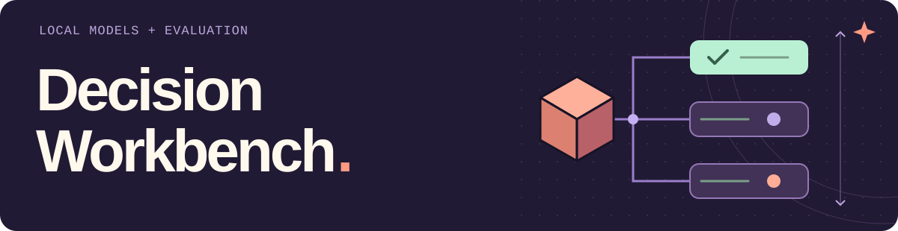
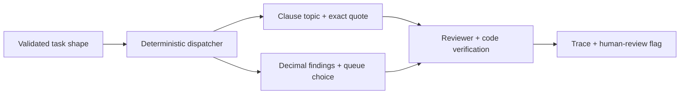

<picture>
  <source media="(max-width: 600px)" srcset="assets/readme-header-mobile.svg">
  
</picture>

Compare small typed decision models and a general language model behind the same
`choose(state, question, options)` interface. Inspect the raw choices, reverse
the options, and keep the mistakes in the report.

The project has two separate experiments: a **frozen public-data comparison**
and a **bounded review workflow** for fictional clauses and synthetic invoices.
Both run locally; neither executes legal or financial actions.

[Recorded model comparison](reference/public-v1/README.md) ·
[Evaluation protocol](docs/public-evaluation.md) · [API examples](docs/api-examples.md) ·
[Assistance & attribution](AI_ASSISTANCE.md)

## Start without weights

Python **3.11+**, from the repository root:

```sh
python3 -m venv .venv
.venv/bin/python -m pip install -r requirements.lock
.venv/bin/python -m workbench.harness --backend rules --out .local/readme-demo
```

This runs the actual LangGraph workflow using a transparent rules baseline.
Selected fields from the CLI output:

```json
{
  "backend": "rules-baseline",
  "routingMode": "shape",
  "cases": 20,
  "categoryCases": 19,
  "categoryCorrect": 17,
  "contractFailures": 0,
  "neuralDecisionAttempts": 0
}
```

The rules miss the ambiguous and negated clauses. Those errors remain in
`.local/readme-demo/traces.jsonl`; the summary and source/data hashes are saved
alongside it. These are **synthetic development cases**, not held-out data or
model-quality measurements.

## Three models, the same public examples

The [recorded comparison](reference/public-v1/README.md) contains **50 CUAD
contract excerpts** across five clause types and **80 BANKING77 support queries**
across eight intents. Each model answered every case in original and reversed
option order: **780 measured decisions**, plus three separate warmups.

| Checkpoint + adapter | BANKING77 correct | CUAD correct | Choice changes after reversal · BANKING77 / CUAD |
| --- | ---: | ---: | ---: |
| DecisionTune 1.0 · native decision head | 57 / 80 | 32 / 50 | 11 / 80 · 4 / 50 |
| Laya Multilingual · native decision head | 53 / 80 | 35 / 50 | 27 / 80 · 10 / 50 |
| Qwen3-0.6B · candidate-letter token scoring | 12 / 80 | 12 / 50 | 64 / 80 · 41 / 50 |

Correctness above uses the original option order, with all planned cases in the
denominator. Every call completed in this run. The Qwen result is deliberately
retained: this particular no-generation adapter performed poorly and was highly
sensitive to option order. It does not measure every way to use Qwen.

These are small, selected-label adaptations of public test data. **BANKING77 is a
declared DecisionTune training source**; exposure for all other model/task pairs
is unknown. The results do not establish unseen-data performance or model
superiority. The full report includes macro F1, source-group bootstrap intervals,
confusion matrices, timings, limits and every prediction.

Verify the data and recompute the report **offline, without model weights**:

```sh
.venv/bin/python -m workbench.datasets verify --out benchmarks/public-v1
.venv/bin/python -m workbench.benchmark_report --runs reference/public-v1
```

The second command finishes with:

```text
Verified 3 runs; metrics recomputed offline from all frozen predictions.
```

[Download and rerun the pinned models on Apple silicon](reference/public-v1/README.md#run-the-models-again-on-apple-silicon).
Weights stay outside Git. The checked-in artifacts preserve their execution
commit, dataset hashes, checkpoint revisions and package versions.

## Try a typed decision over HTTP

Start the loopback API using the same rules baseline:

```sh
.venv/bin/python -m workbench.api --backend rules --port 8080
```

In another terminal:

```sh
curl -sS http://127.0.0.1:8080/v1/decisions \
  -H 'Content-Type: application/json' \
  --data '{"state":{"role":"legal_analyst","document":{"text":"Keep the information confidential."}},"question":"Which clause topic is present?","options":{"confidentiality":"Protect disclosed information","payment":"Fees or payment deadlines"}}'
```

Actual response:

```json
{"choice":"confidentiality","probabilities":{"confidentiality":1.0,"payment":0.0},"margin":1.0,"backend":"rules-baseline"}
```

Those one-hot values encode a rule's output, not neural confidence. The API also
accepts `POST /v1/reviews` for a full workflow task; see the
[request and response examples](docs/api-examples.md). `/healthz` reports readiness
and `/openapi.json` describes the strict request schemas.

The server binds to `127.0.0.1`, serializes provider access, bounds input sizes
and disables hosted tracing. It currently serves rules or a verified local
DecisionTune snapshot. It is a local study API, not a Jev wire-protocol server.

## Follow the review workflow



- **Contract triage:** classify a fictional clause and attach a literal source
  quote with Unicode offsets. Every legal result requires human review.
- **Invoice reconciliation:** calculate exact Decimal findings in code, then ask
  the model to classify the findings. Tenant scope, currency, duplicates and
  model disagreement remain explicit checks. No payment is approved.
- **Bounded roles:** deterministic dispatch followed by at most two provider
  calls. `--routing model` retains the learned-router experiment with a three-call
  cap. Low margins, missing evidence and backend errors remain visible gates.

The graph is programmed and bounded. A literal quote can be accurate while its
classification is wrong; correct arithmetic does not make a model's queue choice
correct. Neural scores are uncalibrated, and the margin is a routing heuristic.

Earlier [synthetic workflow results](reference/README.md), including the failed
learned router, remain unchanged. They answer a different question from the
public classification experiment.

## Test, inspect, extend

```sh
.venv/bin/python -m pytest
```

[Study design](docs/study-design.md) · [Dataset provenance](docs/datasets.md) ·
[Evaluation tradeoffs](docs/public-evaluation.md) · [Third-party notices](NOTICE) ·
[AI assistance](AI_ASSISTANCE.md) · [MIT license](LICENSE)

No model was trained here. No paid API, real account, legal advice, payment,
customer outcome or production deployment is claimed. Owner study and human
review remain separate from automated verification.
